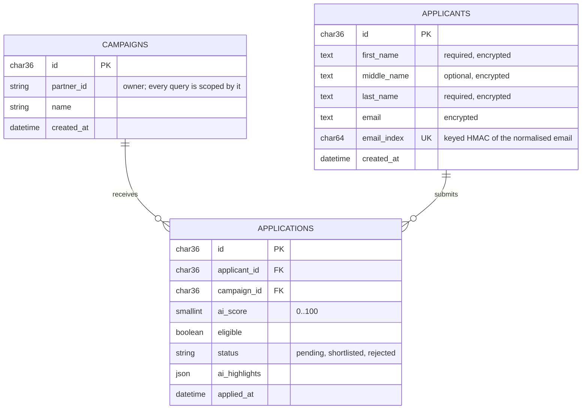
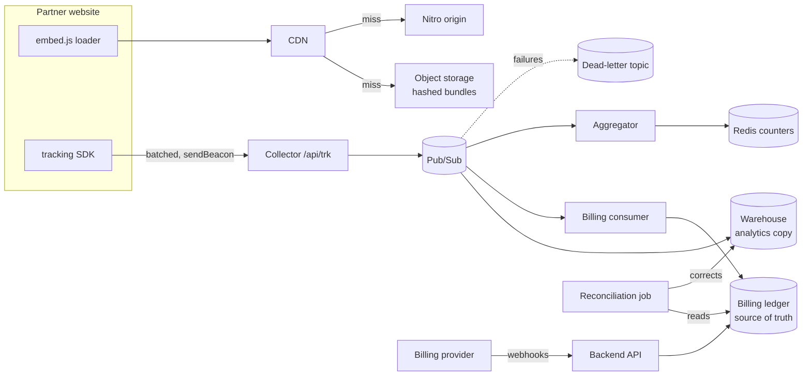
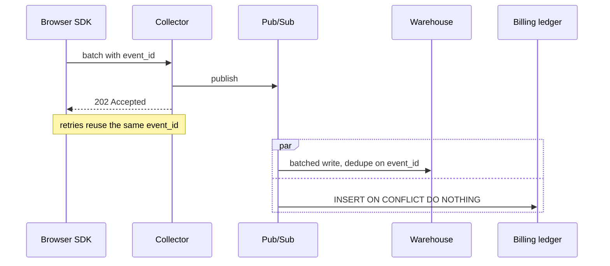

# TASK_REPORT: B2B Full-Stack Practical Task

| Task | Where | Status |
|---|---|---|
| 1 · Laravel endpoint + business logic | [`backend/`](backend/) | Done: 166 PHPUnit tests (701 assertions), all passing |
| 2 · Nuxt component + state | [`frontend/`](frontend/) | Done: 109 Vitest tests + 23 Playwright E2E tests, all passing; `nuxt typecheck` clean |
| 3 · AI tooling showcase |  | Done |
| 4 · Architecture & triage | TaskReport.md|(#4-real-world-architecture--multi-service-triage) | Done

## Scope and deliberate decisions

### Required by the brief

| Brief requirement | Where it is met |
|---|---|
| `GET /api/v1/campaigns/{campaignId}/applicant-summary` with controller + service | [ApplicantSummaryController](backend/app/Http/Controllers/Api/V1/ApplicantSummaryController.php), [ApplicantSummaryService](backend/app/Services/ApplicantSummaryService.php) |
| Validate `campaignId`, verify authorization with a mock header/middleware | UUID validation → 422; [AuthenticatePartner](backend/app/Http/Middleware/AuthenticatePartner.php) → 401; partner-scoped lookup → 404 |
| Totals, eligible count, average AI score, top-tier highlights | `meta.summary`, from one aggregate SQL query |
| `?min_score=` and `?page[size]=&page[number]=` | [ApplicantSummaryRequest](backend/app/Http/Requests/ApplicantSummaryRequest.php) |
| JSON:API response and error objects | `data` / `meta` / `links` on success, `errors[]` on failure |
| PHPUnit: 200, 422/404, empty campaign without division by zero | [tests/Feature/Api](backend/tests/Feature/Api/), [tests/Unit](backend/tests/Unit/) |
| Reusable `<script setup lang="ts">` card consuming the endpoint | [ApplicantMatchCard.vue](frontend/components/applicant/ApplicantMatchCard.vue) |
| Name, colour-coded score, date, AI bullets | the card |
| Shortlist / Reject with optimistic updates | card + [store](frontend/stores/applicantReview.ts) |
| Loading skeleton and empty state; minimum-score filter | [ApplicantReviewBoard.vue](frontend/components/applicant/ApplicantReviewBoard.vue) and its [child components](frontend/components/applicant/) |
| At least one Vitest or Playwright test (render + interaction) | both: [tests/unit](frontend/tests/unit/), [tests/e2e](frontend/tests/e2e/) |
| TASK_REPORT with AI prompts, raw vs refactored code, judgment, velocity; architecture with Mermaid | §3 and §4 below |

### Additions and decisions beyond the brief

The brief asks for one campaign-scoped endpoint and a card component. It does not ask for navigation, extra filters or other endpoints. I added the items below because a per-campaign endpoint implies partners run several campaigns, and a real portal needs a way to choose one and work through its applicants. Each addition is small, tested, and built on the same patterns as the required work.

| Addition | Why |
|---|---|
| Campaign list (`GET /api/v1/campaigns`, `/` page) linking to each campaign's applicants | The summary endpoint is per campaign, so partners need a way to pick one. It also makes tenant isolation visible: another partner's campaign never appears. |
| `PATCH /api/v1/applications/{applicationId}` and a Pending action | The brief says "retrieve **and manage**"; optimistic Shortlist/Reject needs a real endpoint to confirm or roll back against. Pending lets a reviewer undo a decision. |
| Separate `applicants` and `applications` tables | The same person will be able to apply to several campaigns. Scores, status and highlights belong to one submission, not to the person, so they live on `applications`. See [Data model](#data-model). |
| Status and application-date filters, sorting, rows per page | Makes a list of dozens of applicants workable. Everything is done by the API using JSON:API `filter[...]`, `sort` and `page[...]` conventions. |
| Top-tier dialog; highlight for scores above 90 | The top-tier summary was truncated in the tile. The highlight makes standout applicants easy to spot. |
| JSON:API content negotiation (415/406), 400 for unsupported sort | Follows the JSON:API spec rules that apply to these endpoints. |
| Nitro backend-for-frontend with an in-repo mock | Keeps the partner token out of the browser, and lets the frontend and its tests run without PHP. |
| Structured logging with one request id | One `X-Request-Id` follows each request from the browser through Nuxt and Laravel to the database, so the "Reference" shown in the UI finds every related log line. Logs are redacted JSON. |
| Strict Content-Security-Policy and security headers | A nonce-based CSP blocks injected scripts even if escaping fails. `frame-ancestors 'none'`, HSTS and the other headers stop clickjacking and HTTP downgrades. Checked by [security.spec.ts](frontend/tests/e2e/security.spec.ts). |
| Append-only `audit_log` table for review decisions | Who shortlisted or rejected an applicant is a business record, not a log line, so it is kept in the database. Every real status change stores the partner, the application, the old and new status, the campaign, the request id and the time, in the same transaction as the change. The trail can therefore never miss a change or record one that didn't happen. The table has no updates or deletes. It is indexed by application and by partner and time, so the history of one application or one partner's activity is a single query. |
| Personal data encrypted at rest | Applicant names and email are stored encrypted with keys from Google Cloud KMS, so a leaked database or backup holds no names or emails. Email uniqueness uses a keyed hash (blind index), and sorting by name happens in PHP because ciphertext can't be ordered. |

### PrimeVue license key committed on purpose

PrimeVue 5 requires a PrimeUI license key. Without one, the app logs "PrimeUI license is not configured" in the server and browser consoles. I committed the key in [`frontend/.env.example`](frontend/.env.example) intentionally, so reviewers can copy it to `.env` and run the portal without registering for their own key.

THIS IS NOT A SECURITY ISSUE!

In a production codebase, I would still inject the key from the deployment's secret store rather than the repository, to keep one consistent rule for every key.

---

## 1. Backend API (Laravel 13 · PHP 8.3 · Doctrine ORM 3 · JSON:API)

### Endpoints

| Method | Path | Purpose |
|---|---|---|
| `GET` | `/api/v1/campaigns` | The partner's own campaigns with application, eligible and per-status counts and the average AI score, each linking to its applicant summary (`page[size]`, `page[number]`) |
| `GET` | `/api/v1/campaigns/{campaignId}` | One campaign, only if it belongs to the caller (404 otherwise, 422 malformed id). Used by the portal to check access before a campaign page renders |
| `GET` | `/api/v1/campaigns/{campaignId}/applicant-summary` | Campaign metrics + filtered, sorted, paginated applications, with their applicants in `included` |
| `PATCH` | `/api/v1/applications/{applicationId}` | Change an application's status (`pending` / `shortlisted` / `rejected`); backs the Shortlist, Reject and Pending buttons |

All endpoints require `Authorization: Bearer <token>` (mock partner auth, see `config/partners.php`). The flow is list-then-detail: a partner lists their campaigns, then follows `links.applicantSummary` for one campaign. The status change targets the application itself, because status belongs to one submission, not to the person. The application is only found if its campaign belongs to the calling partner; otherwise the answer is 404.

### Data model

`applicants` holds the person; `applications` holds one person's submission to one campaign. The same applicant can have applications in several campaigns, each with its own score, eligibility, status and highlights.



- **One application per person per campaign:** `UNIQUE (applicant_id, campaign_id)`.
- **Indexes for the summary:**
  - `(campaign_id, ai_score)` serves the score filter, the default sort and the top-tier query.
  - `(campaign_id, status)` serves the status filter and the campaign list counts.
  - `(campaign_id, applied_at)` serves the application-date filter and the date sort; SQLite's query plan confirms it is used.
  - On `campaigns`, the primary key serves single-campaign lookups, and `partner_id` serves the campaign list.
- **Foreign-key indexes are kept on purpose.** Doctrine DBAL adds a single-column index on each foreign key (`campaign_id`, `applicant_id`) unless an index on exactly those columns exists; a wider composite index doesn't count, by design. They overlap with the composites above, but removing them would mean fighting the schema tool for a negligible write saving.
- **Names are stored in parts:** `first_name` and `last_name` are required, and `middle_name` is optional. The demo data leaves the middle name empty. The API returns the three parts, the UI composes the display name ("First Middle Last", skipping an empty middle name).
- **Names and email are encrypted at rest** with keys from Cloud KMS, and email uniqueness uses a keyed blind index (`email_index`). Name sorting therefore happens in PHP after decryption rather than through an SQL index. See [Additions and decisions beyond the brief](#additions-and-decisions-beyond-the-brief).
- **Deleting** a campaign or an applicant cascades to their applications.
- **Applicants are shared across partners** in this model. The API never reveals that a person applied elsewhere: every response is scoped to one campaign of the calling partner, and email never leaves the API. If partners must not share a person record at all, `applicants` would gain a `partner_id` and the unique blind-index key would become `(partner_id, email_index)`.

Query parameters for `GET` follow JSON:API 1.1 conventions:

| Parameter | Example | Notes |
|---|---|---|
| `min_score` | `min_score=80` | 0..100. Kept as named in the brief. It is a valid JSON:API implementation-specific parameter because it contains a non a-z character. |
| `filter[status]` | `filter[status]=shortlisted` | `pending`, `shortlisted` or `rejected` |
| `filter[applied_from]`, `filter[applied_to]` | `filter[applied_from]=2026-09-01&filter[applied_to]=2026-09-30` | `YYYY-MM-DD`, inclusive whole UTC days; `to` must be on or after `from` |
| `sort` | `sort=-appliedAt` | `-aiScore` (default), `aiScore`, `-appliedAt`, `appliedAt`, `name`, `-name`. `name` sorts like a directory: last name, then first name, then middle name. Anything else returns **400**, as JSON:API requires. |
| `page[size]`, `page[number]` | `page[size]=12&page[number]=2` | size 1..100 (default 10), number ≥ 1 |

### Request flow and layering

```
EnsureJsonApiMediaType           JSON:API content negotiation: 415 / 406
  → AuthenticatePartner          Bearer token → partner_id (constant-time compare), else 401
  → ApplicantSummaryRequest      campaignId UUID, min_score, filter[...], page[...] (else 422); sort allow-list (else 400)
  → ApplicantSummaryController   thin: request → DTO → service → JSON:API document
  → ApplicantSummaryService      campaign lookup scoped to partner (else 404), orchestrates metrics + page
  → ApplicationRepository (interface) ← DoctrineApplicationRepository (DQL, applicant fetch-joined)
  → ApplicantSummaryDocument     data[] applications + included[] applicants + meta + links
JsonApiErrorRenderer             every exception under /api/* → { errors: [{ status, code, title, detail, source }] }
```

Key files:
- [ApplicantSummaryService.php](backend/app/Services/ApplicantSummaryService.php)
- [Applicant.php](backend/app/Entities/Applicant.php), [Application.php](backend/app/Entities/Application.php)
- [DoctrineApplicationRepository.php](backend/app/Repositories/Doctrine/DoctrineApplicationRepository.php)
- [CampaignMetrics.php](backend/app/Services/Dto/CampaignMetrics.php)
- [ApplicantSummaryDocument.php](backend/app/Http/JsonApi/ApplicantSummaryDocument.php)
- [JsonApiErrorRenderer.php](backend/app/Http/JsonApi/JsonApiErrorRenderer.php)

### Response (abridged, from the seeded demo campaign)

```json
{
  "jsonapi": { "version": "1.1" },
  "data": [
    {
      "type": "applications",
      "id": "00000000-0000-4000-8000-000000000028",
      "attributes": {
        "aiScore": 98, "tier": "top", "eligible": true, "status": "shortlisted",
        "aiHighlights": ["Fluent in three languages, including the programme language", "…"],
        "appliedAt": "2026-09-28T09:27:00+00:00"
      },
      "relationships": {
        "applicant": { "data": { "type": "applicants", "id": "00000000-0000-4000-a000-000000000028" } },
        "campaign": { "data": { "type": "campaigns", "id": "9b2f0f7e-…" } }
      }
    }
  ],
  "included": [
    { "type": "applicants", "id": "00000000-0000-4000-a000-000000000028", "attributes": { "firstName": "Luka", "middleName": null, "lastName": "Fischer" } }
  ],
  "meta": {
    "campaign": { "id": "9b2f0f7e-…", "name": "Global Scholars Programme 2026" },
    "summary": {
      "totalApplicants": 28, "eligibleApplicants": 13, "eligibleRate": 46.4, "averageAiScore": 67.46,
      "topTierCount": 8,
      "topTier": [{ "applicationId": "…", "applicantId": "…", "name": "Luka Fischer", "aiScore": 98, "aiHighlights": ["…", "…"] }]
    },
    "filters": { "minScore": 80, "status": null, "appliedFrom": null, "appliedTo": null },
    "sort": "-aiScore",
    "page": { "number": 1, "size": 2, "total": 9, "lastPage": 5 }
  },
  "links": { "self": "…", "first": "…", "prev": null, "next": "…page%5Bnumber%5D=2", "last": "…" }
}
```

Error example (`GET /api/v1/campaigns/nope/applicant-summary?min_score=x`):

```json
{ "jsonapi": { "version": "1.1" }, "errors": [
  { "status": "422", "code": "validation_failed", "title": "Invalid attribute",
    "detail": "The campaign id must be a valid UUID.", "source": { "parameter": "campaignId" } },
  { "status": "422", "code": "validation_failed", "title": "Invalid attribute",
    "detail": "The min score field must be an integer.", "source": { "parameter": "min_score" } } ] }
```

### Design decisions

- **Aggregation happens in the database.** Metrics come from one DQL query with `COUNT`, `SUM(CASE…)` and `AVG`. The same query also counts top-tier applicants (`SUM(CASE WHEN ai_score >= 85 …)`). The page comes from one `LIMIT/OFFSET` query and the filtered total from one `COUNT`. The top-tier preview is one `LIMIT 5` query. The request never loads every application, and each page query fetch-joins the applicant, so names cost no extra queries: no N+1 and no O(n) memory use. The composite index `(campaign_id, ai_score)` serves the filter, the sort and the top-tier query.
- **No division by zero, by construction.** `AVG()` over zero rows is `NULL`, and `CampaignMetrics::fromAggregates()` maps that to `0.0`. The service also skips the list queries entirely for an empty campaign.
- **Scope of the metrics.** `meta.summary` is **campaign-wide**. `min_score`, `filter[...]` and `sort` affect only `data`, and `meta.page.total` reflects the filtered count. A partner changing filters still sees stable campaign KPIs. The active filters and sort are echoed in `meta.filters` and `meta.sort`.
- **Malformed versus unknown IDs.** A malformed ID returns 422 with `source.parameter`, which makes it actionable for API consumers. A well-formed but unknown ID returns 404. **Another partner's campaign also returns 404**, never 403, so IDs cannot be enumerated.
- **Stable pagination.** Every sort ends with `id ASC` as a tiebreaker; the default is `ai_score DESC, applied_at ASC, id ASC`. A test proves that tied scores never duplicate or drop an applicant across pages.
- **JSON:API details.**
  - Responses use `Content-Type: application/vnd.api+json` and include the `jsonapi` object.
  - Filtering uses the `filter[...]` family, sorting uses `sort` with `-` for descending, and paging uses `page[size]` and `page[number]`.
  - An unsupported `sort` returns `400 Bad Request`. Other invalid input returns `422`.
  - Content negotiation: request bodies must be `application/vnd.api+json` (plain `application/json` and unsupported media type parameters return `415`), and must be a well-formed JSON object (`400`). An `Accept` header whose JSON:API entries all carry unsupported parameters returns `406`.
  - Unknown query parameters return `400` (JSON:API), unknown document members return `422` with a JSON pointer, and numbers must be canonical integers. The full rule table is in the README under "Strict validation".
  - Errors use `source.parameter` for URL inputs and `source.pointer` for body inputs.
  - A type or id mismatch in the PATCH body returns `409 Conflict`, as the spec requires.
  - `links` preserve active filters and sort.
- **Security hygiene.**
  - Bearer tokens are compared in constant time.
  - The rate limiter is keyed by a SHA-256 hash of the token, never the raw token.
  - `page[size]` is capped at 100.
  - Emails never appear in list responses.
  - Responses carry `Cache-Control: private, no-store` because the data is partner-scoped.
- **Doctrine specifics.** Entities are mapped with attributes and have no public setters. Status changes go through `Application::changeStatus()`, called by the `ChangeApplicationStatus` action; `ApplicantSummaryService` only reads. `Applicant` holds only name and email, so it stays stable while applications change. Repositories sit behind interfaces, so the service is unit-tested with mocks and has no database dependency.

- **Callers ask `Application`, not its relations.** `applicantId()`, `applicantName()` and `campaignId()` live on `Application`, so the JSON:API resource never reaches through it into the applicant or campaign (Law of Demeter). If that relationship changes, only `Application` changes. Covered by `ApplicationTest`.

### Test matrix (`php artisan test`)

| Area | Test |
|---|---|
| 200 + correct aggregates | exact average (78.67), eligible rate, top-tier count and order, tiers, JSON:API structure, email never leaked |
| Filtering | `min_score` narrows `data` and `meta.page.total` but not the campaign-wide summary; `filter[status]`; inclusive `filter[applied_from]`/`filter[applied_to]` at day boundaries; filters combine and survive pagination links |
| Sorting | all six `sort` values; `name` orders by last name, then first name (with a middle name in the data); unsupported sort → 400 with `source.parameter: sort` |
| Invalid filters | unknown status, bad date format, range ending before it starts, unknown `filter[...]` key → 422 |
| Content negotiation | JSON:API body with unsupported media type parameter → 415; plain `application/json` body → 415; plain `application/vnd.api+json` body accepted; parameterised `Accept` → 406 |
| Strict validation (39 cases) | unknown query parameters → 400 on every endpoint (incl. `include`, `fields`, every unknown name reported); non-canonical numbers (`+80`, ` 80`, `80.0`, `8e1`, `080`, empty, arrays) → 422; wrong-case status, impossible dates, date-times → 422; multi-field or array sort → 400; malformed, empty, array or scalar body → 400; unknown top-level member, `relationships`, read-only attribute → 422 with pointer and nothing written; non-UUID `data.id`, non-string `data.type`, empty attributes → 422; query parameters on PATCH → 400 |
| Domain invariants (unit, 17 cases) | campaign, applicant and application reject blank or oversized names, invalid email, non-UUID ids, scores outside 0..100, and malformed highlight lists; valid input is trimmed and normalised |
| Campaign show | own campaign → 200 with `self` and `applicantSummary` links; another partner's or unknown → same 404; malformed id → 422; no token → 401 |
| Campaign list | only the partner's own campaigns; per-status counts, eligible count and rate, and average; zeroes for an empty campaign; `links.applicantSummary`; pagination; 401; 422 on bad paging |
| Pagination | `page[size]`/`page[number]`, `lastPage`, prev/next links keep `min_score`; tie-stable ordering |
| Empty campaign | 200, `data: []`, zeroed aggregates, `lastPage: 1`, null prev/next |
| Auth | 401 with `WWW-Authenticate: Bearer` for missing or unknown token |
| Tenant isolation | foreign campaign returns the same 404 as a missing one; PATCH across partners/campaigns returns 404 and leaves data unchanged |
| Validation (8 cases) | malformed / SQL-ish UUID, `min_score` 150 or non-numeric, `page[size]` 0 or 500, `page[number]` 0, unknown `page[offset]` → 422 with `source.parameter` |
| PATCH `/applications/{id}` | success persists and returns the applicant in `included`; **the same person can be shortlisted in one campaign and rejected in another**; invalid status → 422 with `source.pointer`; malformed id → 422; id or type mismatch → 409; another partner's application or an unknown id → 404 |
| Personal data encryption | raw rows hold only ciphertext and the email blind index; reads return plaintext; lookup by blind index; duplicate email in another case → unique violation; `sort=name` orders and pages over encrypted names. Unit: AES-GCM round trip, fresh nonce, tamper detection, key rotation, unknown key id; blind index is keyed, case-insensitive and field-scoped; local provider refused in production; Cloud KMS unwrap, metadata token, caching and error handling with a faked HTTP client |
| Unit | `Applicant` name rules (optional middle name skipped in the full name, trimming, required first and last name), `CampaignMetrics` (NULL aggregates, driver strings, rounding), `ScoreTier` boundaries, service skips list queries for an empty campaign and always scopes by partner |

---

## 2. Frontend (Nuxt 4 · Vue 3.5 · Pinia · PrimeVue 5 · Tailwind 4 · TypeScript)

### Structure

| File | Role |
|---|---|
| [components/campaign/](frontend/components/campaign/) | `CampaignList`: the landing page (`/`) as a PrimeVue DataTable, one row per campaign with applicants, eligible (count and %), average AI score and review progress (`CampaignProgressTags`). The name links to `/campaigns/<id>`; the whole row is clickable and ends in a chevron. |
| [components/applicant/](frontend/components/applicant/) | `ApplicantReviewBoard` orchestrates the review page from focused children: `ApplicantSummaryTiles`, `ApplicantFilterBar`, `ApplicantMatchCard` (with `ApplicantScoreBadge` and `ApplicantStatusTag`), `ApplicantCardSkeleton`, `ApplicantDetailsDialog` and `ApplicantTopTierDialog`. The card is reusable and stateless: Shortlist, Reject and Pending in one row, a divider, then View details; scores above 90 are highlighted as "Standout". |
| [components/base/](frontend/components/base/) | Domain-free building blocks: `BaseStatTile`, `BaseEmptyState`, `BaseLoadError` (message, support reference, retry) and `BasePaginator` (PrimeVue Paginator speaking 1-based API pages) |
| [components/layout/](frontend/components/layout/) | Page frame: `PageContainer` and `BackBreadcrumb` |
| [composables/](frontend/composables/) | `useCampaignList` (fetch and paging of the campaign table), `useApplicantFilters` (debounced score, date range, status, sort, reset, top tier), `useLazyPaging` (paginator ↔ JSON:API pages, shared by both lists), `useStatusErrorToast`, `useFormatters` (dates and averages from the locale), `usePageTitle` |
| [i18n/locales/en.json](frontend/i18n/locales/en.json) | Every user-facing label, via `@nuxtjs/i18n`. A unit test fails if the source uses a key that is not in the file. |
| [stores/applicantReview.ts](frontend/stores/applicantReview.ts) | Pinia setup store: filters, sort and paging with stale-response protection; optimistic, serialised `setStatus()` with rollback |
| [types/applicant.ts](frontend/types/applicant.ts) | JSON:API contract types: `applications` with `applicants` relationships (mirror of the Laravel document) |
| [utils/jsonApi.ts](frontend/utils/jsonApi.ts) | Resolves each application's applicant through `relationships` and `included`, and flattens both into the `ReviewItem` the UI renders |
| [utils/scoreTier.ts](frontend/utils/scoreTier.ts) | Tier → colour mapping only; the tier and all thresholds come from the API (`meta.thresholds`) |
| [server/api/portal/…](frontend/server/api/portal/) | Nitro **backend-for-frontend**: proxies to Laravel when `NUXT_BACKEND_URL` is set, otherwise serves an in-memory mock with the same contract |

### Labels, composables and component folders

**Labels.** Every user-facing string now lives in [frontend/i18n/locales/en.json](frontend/i18n/locales/en.json) and is read through `@nuxtjs/i18n`. Before, the same words were scattered across components, the error page and the store. "Pending review", for example, existed twice. Wording changes, plurals ("1 applicant" / "2 applicants") and a second language now need no component changes. Dates use the locale's formats in UTC, so server and client render the same text.

vue-i18n accepts any string as a key, so a typo would compile and show the raw key. [tests/unit/i18nKeys.spec.ts](frontend/tests/unit/i18nKeys.spec.ts) reads every key used in the source and fails if one is missing from the locale file.

**Composables, where they earn their place.**

| Composable | Why it is a composable |
|---|---|
| `useCampaignList` | Fetching, paging, keeping the last page visible during a page change, and navigation were mixed into the table template. The component now only renders. |
| `useApplicantFilters` | The debounce timer, the date-picker ↔ API day conversion, reset and "show top tier" are stateful logic with cleanup. Moving them out let the filter bar become a presentational component. |
| `useLazyPaging` | The paginator's 0-based rows ↔ the API's 1-based pages, plus the paginator layout and report text, were written twice. Now the board and the campaign table share one implementation. |
| `useStatusErrorToast` | Turning a rolled-back status change into a translated toast is a side effect with its own lifecycle, not board layout. |
| `useFormatters`, `usePageTitle` | Formatting and page titles depend on the i18n context, and the card, the table and every page need them. |

**Kept as plain functions, on purpose:**
- `toIsoDay` and `fromIsoDay` in `utils/isoDay.ts` hold no state and need no component context. A composable would only add ceremony, and plain functions are trivial to unit test.
- `ApplicantMatchCard` has no composable of its own. It is a stateless, presentational component whose few computed values exist only for its own template. Extracting them would hide simple code behind an indirection with a single caller. It does use the shared `useFormatters`.

**Components by role.** The board was one 400-line file. It now orchestrates focused children, and the folders say what each component is for:

```
components/
├── base/        BaseStatTile, BaseEmptyState, BaseLoadError, BasePaginator      (no domain knowledge)
├── layout/      PageContainer, BackBreadcrumb                                    (page frame)
├── campaign/    CampaignList, CampaignProgressTags
└── applicant/   ApplicantReviewBoard, ApplicantSummaryTiles, ApplicantFilterBar,
                 ApplicantMatchCard, ApplicantScoreBadge, ApplicantStatusTag,
                 ApplicantCardSkeleton, ApplicantDetailsDialog, ApplicantTopTierDialog
```

Components are registered by file name without a folder prefix, so `<BaseEmptyState>` is written as is. The score badge and status tag are reused by the card and the top-tier dialog. The loading error and paginator are shared by both pages.

This refactor also surfaced a server-rendering bug, described in [Critical Engineering Judgment](#33-critical-engineering-judgment).

---

### Notable behaviour

- **Truly optimistic status changes.**
  - Clicking Shortlist, Reject or Pending changes the card immediately. There is no spinner, "Saving" label or locked button.
  - Requests for the same applicant are serialised: one is in flight and the latest click is queued. The server therefore always ends on the status the user picked last, even with rapid clicks.
  - Only on failure does the card revert to the last saved status, and a toast says "Couldn't do the operation" with the API's error detail.
- **Filters and sorting.**
  - The filter bar sits under the report on a single line with inline labels: "Filters:" then minimum score, application date range and status. "Sort by" is on the far right.
  - Every change goes to the API as JSON:API query parameters and restarts at page 1.
  - The paginator has a rows-per-page selector (6, 12, 24, 48) backed by `page[size]`.
- **Campaign list first.** `/` lists the partner's campaigns. Clicking one opens `/campaigns/<id>`, which has an "All campaigns" link back. The board has no visible title; a screen-reader-only heading keeps it accessible. Switching campaigns starts from clean filters, sort and page.
- **Top tier.** The report tile shows how many applicants scored 85 or more. "View all" opens a dialog listing the top five with scores and highlights. "Show all N in the list" filters the list to 85+ sorted by score.
- **Race-free filtering.** Slider changes are debounced, and each request carries a monotonic id. A slow response for an old filter can never overwrite the newer list. A dedicated store test covers this.
- **Loading and empty states.**
  - Skeleton cards shaped like the real card appear on the first load, with `role="status"`.
  - Later loads dim the existing cards instead, so the layout does not jump.
  - There are two distinct empty states: "no match for this filter", with a Reset button, and "campaign has no applicants yet".
- **The partner token never reaches the browser.** The browser only calls `/api/portal/*`. Nitro attaches the server-only `partnerToken` and rewrites Laravel's absolute pagination links so the internal hostname never leaks.
- **Accessibility.**
  - Real buttons carry `aria-pressed` and `aria-label`.
  - Status changes are announced through `aria-live`.
  - The native range input is labelled.
  - The badge includes screen-reader text such as "92 out of 100, Top match".
  - Badge colours are AA-contrast tints.
- **SSR-safe.** The first page renders on the server and Pinia state hydrates without a refetch. Dates are formatted with a fixed locale in UTC, so server and client output match.

### Tests

- **Vitest** (`npm test`, 109 tests, `@nuxt/test-utils` in the Nuxt environment, endpoints served by the same mock contract):
  - Card: renders name, badge, date, status and highlights; badge colour follows the `tier` the API sent (never recomputed); standout highlight follows the API threshold (91 vs 90, custom thresholds, none); buttons in one row, then divider, then View details; typed emits; no loading state; missing data.
  - Campaign list: a PrimeVue DataTable (one row per campaign, the name links to its board and the whole row is clickable); only own campaigns, links to each board, empty state; paginator hidden when everything fits, otherwise pages through the API with `page[size]`/`page[number]`; another partner's campaign is a 404 in the mock too.
  - Board: all thresholds (tile label, standout, "show all" filter) follow `meta.thresholds`, so changing them in the API needs no UI change; no visible title; single-row filter bar under the report with Sort by last; clean filters when switching campaign; **slider, status, date range and sort each change the DOM**; rows per page; empty state and reset; empty campaign; skeleton while loading; Top tier dialog and "show all"; **status changes instantly with no loading state**; **revert plus toast on 503**.
  - JSON:API: applicants are resolved through relationships, not array position; a missing included applicant does not crash; the same person in two campaigns keeps separate statuses.
  - Store: stale-response protection; JSON:API query parameters; error surfacing; page resets on filter, sort and size changes; **rapid clicks are serialised so the last choice wins**; rollback to the last saved status.
- **Playwright** (`npm run test:e2e`, 23 tests against a production `nuxt build`):
  - Campaign table is server-rendered with its rows; campaign list table → campaign (by the name link and by clicking the row) → back.
  - SSR render.
  - Slider filtering, empty state and reset.
  - Shortlist, then back to pending.
  - Revert and toast with an intercepted 503.
  - Status filter and sort.
  - Empty campaign.
  - **Security headers and CSP:** every header present; a fresh nonce per load; an injected `` and a `javascript:` link are blocked; normal use causes no CSP violation.
  - **Page access:** malformed id → 400; unknown campaign → 404; another partner's campaign → same 404; bad `Authorization` header → 401; bad session cookie → 401; the other partner's cookie opens their campaign and gets 404 on ours; blocked in-app navigation; "Back to campaigns". Each case asserts the real HTTP status and that the board never rendered.
- **Vitest, error page:** the "Page not accessible" page for 400, 401, 403, 404, 503 and an unexpected error, including a reason that arrives as a JSON string in the server payload.

### Page access checks (before render)

The campaign page is guarded by a Nuxt route middleware, [middleware/campaign-access.ts](frontend/middleware/campaign-access.ts), declared with `definePageMeta({ middleware: ['campaign-access'] })`. Nuxt runs it before the page component is created: on the server for a direct load and in the browser for in-app navigation. On failure it calls `abortNavigation(createError({ statusCode, … }))`. Nuxt then renders [error.vue](frontend/error.vue), a dedicated "Page not accessible" page, and sets that status on the HTTP response.

| Check | How | Failure |
|---|---|---|
| Campaign id format | `isUuid()` in the middleware; no network call | **400**, "This link is not valid" |
| Authorization | The proxy resolves the partner token from the page request (`Authorization` header, then `portal_session` cookie, then the demo token) and Laravel's `AuthenticatePartner` verifies it | **401**, "You don't have access" (403 is mapped the same way) |
| Campaign exists and belongs to the caller | `GET /api/v1/campaigns/{campaignId}`, a new, cheap JSON:API endpoint scoped by partner | **404**, "Campaign not found", the same for unknown and foreign campaigns |
| Service down | Any other failure | 503, "Campaign service unavailable" |

Design notes:
- **The check uses `useRequestFetch()`.** During SSR it forwards the page request's cookie and `Authorization` header to the proxy. The store uses it for data calls too, so the access check and the data always act as the same partner.
- **404, not 403, for another partner's campaign.** This matches the API, so a partner can't probe which campaign ids exist.
- **The mock follows the real API.** It validates tokens and scopes data per partner, so the E2E tests exercise real 401 and 404 paths without PHP.

---

## 3. AI Tooling & Engineering Showcase

**Assistant used:** Claude Code in VS Code, in plan mode first and then agent mode. The brief mentions Cursor and Gemini; I used Claude Code throughout.

### 3.1 Exact AI Prompts Used

Three of the prompts I used during this task, edited for readability:

**Prompt 1: planning.** The assessment PDF was attached.

> We need to implement the task described in the attached PDF. Lets plan it out first.
> Treat the PDF as the primary source of truth. Do not write or modify any code yet.
>
> First analyze the requirements and create a concrete implementation plan. The plan should cover what needs to be built and why.
>
> 1. The proposed architecture and technology choices.
> 2. Database design, including entities, relationships, indexes, and important constraints.
> 3. API/backend structure and responsibilities.
> 4. Frontend structure and responsibilities, if applicable.
> 5. Business logic and where it should live.
> 6. Performance and scalability considerations.
> 7. Security and validation considerations.
> 8. Testing strategy.
> 9. A step-by-step implementation order.
>
> Pay particular attention to scalability, database performance, N+1 queries, memory usage, indexing, pagination, and aggregation where relevant.
>
> Do not invent requirements that aren't supported by the PDF. If something is ambiguous or missing, explicitly identify it as an open question rather than making an assumption.
>
> Do not create or modify any files until I approve the plan.

The assistant asked three clarifying questions (Eloquent or Doctrine, which frontend test stack, and how to record the AI evidence) and then produced the layered plan this repository follows.

**Prompt 2: splitting applicants and applications.**

> Please restructure the database:
> Create a separate applicants table for applicant data.
>
> Keep application-specific data in the applications table and link each application to an applicant via applicant_id.
> Write a migration that moves existing applicant data into the new table without losing data, and merges duplicate applicants where they can be matched reliably (e.g. by email).
>
> Update the models, relationships and any queries or API endpoints that currently read applicant data from the application.
>
> Before making changes, show me the proposed schema and migration plan.

Result: the separate `applicants` and `applications` tables described in [Data model](#data-model). The demo data is recreated by the seeder, so no data migration was needed.

**Prompt 3: frontend labels, composables and folders.**

> Implement the following:
>
> Labels
>
> Replace hardcoded/repeated labels in the affected areas with the approved maintainable approach.
> Follow the project's existing i18n/component/configuration conventions.
>
> Composables
>
> Refactor:
> CampaignList
> ApplicantReviewBoard
> ApplicantMatchCard
> Move logic into composables only where the approved analysis determined that it improves maintainability, reuse, separation of concerns, or testability.
> Keep simple component-local functions as functions when extracting them would only add unnecessary abstraction.
> Only create components where there is a clear responsibility or reuse opportunity. Do not over-componentize
>
> Folder structure
>
> Create/reorganize the frontend structure using appropriate folders, including where applicable:
>
> base/ — generic reusable UI primitives
>
> layout/ — application/page layout components
>
> campaign/ — campaign-specific components
>
> appropriate applicant/review-related folders
>
> composables/ — reusable Vue composables

Result: the locale file, composables and component folders described in [Labels, composables and component folders](#labels-composables-and-component-folders).

### 3.2 Raw AI Output vs. Final Refactored Code

Each pair shows code as the assistant first produced it, next to the version in the repository now. Pairs 1 and 2 are the first scaffolds of the endpoint and the card. Pairs 3 to 5 are refactors of the assistant's first working version.

#### 1. Campaign summary service (backend)

<table>
<tr><th>Raw AI output</th><th>Final (refactored)</th></tr>
<tr><td>

```php
$campaign = $this->em->find(Campaign::class, $campaignId);
if (!$campaign) {
    throw new NotFoundHttpException('Campaign not found');
}

$applicants = $this->em->getRepository(Applicant::class)
    ->findBy(['campaign' => $campaign]);

$total = count($applicants);
$eligible = count(array_filter($applicants,
    fn ($a) => $a->isEligible()));
$average = array_sum(array_map(
    fn ($a) => $a->aiScore(), $applicants)) / $total;

// … filter + array_slice for the page
```

</td><td>

```php
// The campaign is looked up for the calling partner only (404 otherwise).
$campaign = $this->campaignFor($query->campaignId, $query->partnerId);

// One SQL query: COUNT, SUM(CASE WHEN eligible …), AVG(ai_score),
// SUM(CASE WHEN ai_score >= 85 …) for the whole campaign.
$aggregates = $this->applications->aggregate($campaign, ScoreTier::TOP_THRESHOLD);
$metrics = CampaignMetrics::fromAggregates(
    $aggregates['total'],
    $aggregates['eligible'],
    $aggregates['average'],                 // NULL for no rows → 0.0
    $this->applications->topTier($campaign, ScoreTier::TOP_THRESHOLD, self::TOP_TIER_LIMIT),
    $aggregates['topTier'],
);

// Empty campaign: no list queries, no division.
if ($metrics->totalApplicants === 0) {
    return new ApplicantSummary($campaign, $metrics, [], 0, $query);
}

return new ApplicantSummary(
    campaign: $campaign,
    metrics: $metrics,
    // ORDER BY … id, LIMIT/OFFSET, applicant fetch-joined (no N+1)
    applications: $this->applications->page($campaign, $query->criteria, $query->sort, $query->pageSize, $query->offset()),
    filteredTotal: $this->applications->countMatching($campaign, $query->criteria),
    query: $query,
);
```

</td></tr>
</table>

The raw version loads every applicant into PHP, divides by zero on an empty campaign, and lets any partner read any campaign. The final version aggregates in SQL, scopes the lookup to the partner, and returns early for an empty campaign.

#### 2. Optimistic status change (frontend)

<table>
<tr><th>Raw AI output</th><th>Final (refactored)</th></tr>
<tr><td>

```ts
const props = defineProps(['applicant'])
const status = ref(props.applicant.attributes.status)

async function updateStatus(newStatus: string) {
  status.value = newStatus
  await $fetch(`/api/applicants/${props.applicant.id}`, {
    method: 'PATCH',
    body: { status: newStatus },
  })
}
```

```html
<div class="cursor-pointer …"
     @click="updateStatus('shortlisted')">Shortlist</div>
```

</td><td>

```ts
// stores/applicantReview.ts: the store owns the status; the card only emits.
function setStatus(applicationId: string, status: ApplicationStatus): Promise<boolean> {
  const application = findApplication(applicationId)
  if (!application || !campaignId.value) return Promise.resolve(false)
  if (application.status === status) return inFlight.get(applicationId) ?? Promise.resolve(true)

  if (!confirmed.has(applicationId)) confirmed.set(applicationId, application.status)
  application.status = status                    // optimistic: the UI changes now
  queued.set(applicationId, status)              // rapid clicks: the last one wins
  return inFlight.get(applicationId) ?? startFlush(applicationId)
}

// inside flush(): one request at a time per application
try {
  lastDoc = await requestFetch<ApplicationDocument>(`/api/portal/applications/${id}`, {
    method: 'PATCH',
    headers: { 'Content-Type': 'application/vnd.api+json', Accept: 'application/vnd.api+json' },
    body: { data: { type: 'applications', id, attributes: { status: next } } },
  })
  confirmed.set(id, lastDoc.data.attributes.status)
} catch (error) {
  const current = findApplication(id)            // the list may have been refetched
  const revertTo = confirmed.get(id)
  if (current && revertTo) current.status = revertTo   // rollback
  actionError.value = { /* name, attempted status, API detail, request id → toast */ }
  return false
}
```

```html
<!-- ApplicantMatchCard.vue: real, labelled buttons -->
<Button v-for="action in ACTIONS" :key="action.status"
  :label="$t(`card.action.${action.status}`)" :icon="action.icon"
  :outlined="attrs.status !== action.status"
  :disabled="attrs.status === action.status"
  :aria-pressed="attrs.status === action.status"
  :aria-label="$t('card.actionFor', { action: $t(`card.action.${action.status}`), name: attrs.name })"
  @click="onAction(action.event)" />
```

</td></tr>
</table>

The raw version copies the prop into local state, never rolls back, sends a non-JSON:API body, and uses a clickable `<div>`. The final version keeps the status in the store, serialises requests per application, rolls back to the last confirmed status with a toast, and uses real, labelled buttons.

#### 3. Status changes moved into their own action (single responsibility, command-query separation)

`ApplicantSummaryService` built the read-only summary and also changed statuses. Reads and writes change for different reasons, so the write moved to [app/Actions/ChangeApplicationStatus.php](backend/app/Actions/ChangeApplicationStatus.php).

**Before**: one service did both.

```php
final class ApplicantSummaryService
{
    public function summarise(ApplicantSummaryQuery $query): ApplicantSummary { /* read */ }

    public function changeStatus(string $applicationId, string $partnerId, ApplicationStatus $status): Application
    {
        $application = $this->applications->findForPartner($applicationId, $partnerId)
            ?? throw ApplicationNotFound::withId($applicationId);
        if ($application->status() !== $status) {
            $application->changeStatus($status);
            $this->applications->save($application);
        }
        return $application;
    }
}

// ApplicationStatusController
public function __construct(private readonly ApplicantSummaryService $service) {}
$application = $this->service->changeStatus($id, $partnerId, $status);
```

**After**: the service only reads, and a single-purpose action writes.

```php
/** Query: read-only. */
final class ApplicantSummaryService
{
    public function summarise(ApplicantSummaryQuery $query): ApplicantSummary { /* read */ }
}

/** Command: change one application's status. Idempotent. */
final class ChangeApplicationStatus
{
    public function __construct(private readonly ApplicationRepository $applications) {}

    public function __invoke(string $applicationId, string $partnerId, ApplicationStatus $status): Application { /* … */ }
}

// ApplicationStatusController
public function __construct(private readonly ChangeApplicationStatus $changeStatus) {}
$application = ($this->changeStatus)($id, $partnerId, $status);
```

New unit tests ([ChangeApplicationStatusTest](backend/tests/Unit/ChangeApplicationStatusTest.php)) cover three cases with a mocked repository: the status is changed and saved, repeating the current status writes nothing, and another partner's application is not found.

#### 4. Score thresholds owned by the backend (single source of truth)

The thresholds (top tier 85, strong 70, standout above 90) lived in both `ScoreTier.php` and `frontend/utils/scoreTier.ts`. Changing one side left the UI and the API quietly disagreeing. For example, the badge colour could contradict the `tier` the API returned, and no test would fail.

**Before**: the frontend recomputed tiers and hard-coded the numbers.

```ts
// frontend/utils/scoreTier.ts
export const TOP_THRESHOLD = 85
export const STRONG_THRESHOLD = 70
export const STANDOUT_SCORE = 90
export function scoreTier(score: number): ScoreTier { /* same rules as ScoreTier.php */ }

// ApplicantMatchCard.vue
const tier = computed(() => TIER_STYLES[scoreTier(attrs.value.aiScore)])
const standout = computed(() => attrs.value.aiScore > STANDOUT_SCORE)

// ApplicantReviewBoard.vue
<dt>Top tier ({{ TOP_THRESHOLD }}+)</dt>
```

**After**: the API publishes the numbers, and the UI only renders them.

```php
// backend/app/Enums/ScoreTier.php: the only place the numbers exist
public const TOP_THRESHOLD = 85;
public const STRONG_THRESHOLD = 70;
public const STANDOUT_ABOVE = 90;

public static function thresholds(): array
{
    return ['topTier' => self::TOP_THRESHOLD, 'strong' => self::STRONG_THRESHOLD, 'standoutAbove' => self::STANDOUT_ABOVE];
}

// ApplicantSummaryDocument: meta.thresholds
'thresholds' => ScoreTier::thresholds(),
```

```ts
// frontend/utils/scoreTier.ts: presentation only (tier → colours), no numbers
export const TIER_STYLES: Record<ScoreTier, TierStyle> = { top: {…}, strong: {…}, review: {…} }

// ApplicantMatchCard.vue: uses the tier the API sent; the threshold arrives as a prop
const tier = computed(() => TIER_STYLES[attrs.value.tier])
const standout = computed(() => props.standoutAbove != null && attrs.value.aiScore > props.standoutAbove)

// ApplicantReviewBoard.vue: labels and the "show all" filter read meta.thresholds
const thresholds = computed(() => meta.value?.thresholds ?? null)
<dt>Top tier ({{ thresholds.topTier }}+)</dt>
```

The response now includes:

```json
"meta": { "thresholds": { "topTier": 85, "strong": 70, "standoutAbove": 90 } }
```

A board test changes the thresholds in the API response to 80 and 95. The label, the standout highlight and the "show all" filter all follow without any code change, which proves the UI has no copy of the numbers. The in-repo mock API plays the backend, so it keeps its own copy of the numbers and publishes them the same way.

**Next step, not done yet: generate the types.** The statuses, sort values and response shape are still written by hand in `frontend/types/applicant.ts`. The long-term fix is an OpenAPI spec generated from the backend, for example with Scramble. The TypeScript types would then be generated from that spec with `openapi-typescript`, and CI would fail if the committed types drift. That is worth doing once more than one client consumes the API.

#### 5. Shared behaviour in traits (before / after)

The first working version, generated with Claude Code, repeated four pieces of boilerplate across requests, controllers and entities. Each now lives in one small trait. Traits hold only cross-cutting plumbing: business logic stays in services and repositories, which are injected and mocked in tests.

| Trait | Location | Used by |
|---|---|---|
| `ResolvesPartner` | [app/Http/Requests/Concerns](backend/app/Http/Requests/Concerns/ResolvesPartner.php) | `ApplicantSummaryRequest`, `CampaignIndexRequest`, `UpdateApplicationStatusRequest` |
| `ValidatesJsonApiPagination` | [app/Http/Requests/Concerns](backend/app/Http/Requests/Concerns/ValidatesJsonApiPagination.php) | `ApplicantSummaryRequest`, `CampaignIndexRequest` |
| `RespondsWithJsonApi` | [app/Http/Controllers/Concerns](backend/app/Http/Controllers/Concerns/RespondsWithJsonApi.php) | `ApplicantSummaryController`, `CampaignIndexController` |
| `HasUuid`, `HasCreatedAt` | [app/Entities/Concerns](backend/app/Entities/Concerns/) | `Campaign`, `Applicant` (both); `Application` (`HasUuid`) |

**1. Reading the authenticated partner (`ResolvesPartner`)**

<table>
<tr><th>Before (in three requests)</th><th>After</th></tr>
<tr><td>

```php
use App\Http\Middleware\AuthenticatePartner;

public function partnerId(): string
{
    return (string) $this->attributes->get(AuthenticatePartner::ATTRIBUTE);
}
```

</td><td>

```php
use App\Http\Requests\Concerns\ResolvesPartner;

final class CampaignIndexRequest extends FormRequest
{
    use ResolvesPartner;   // provides partnerId()
}
```

</td></tr>
</table>

**2. JSON:API pagination rules and accessors (`ValidatesJsonApiPagination`)**

<table>
<tr><th>Before (in both list requests)</th><th>After</th></tr>
<tr><td>

```php
public function rules(): array
{
    return [
        'page' => ['sometimes', 'array:size,number'],
        'page.size' => ['sometimes', 'integer',
            'between:1,'.self::MAX_PAGE_SIZE],
        'page.number' => ['sometimes', 'integer',
            'min:1', 'max:100000'],
    ];
}

public function messages(): array
{
    return ['page.array' =>
        'Only page[size] and page[number] are supported.'];
}

public function pageSize(): int
{
    return (int) ($this->validated('page.size')
        ?? self::DEFAULT_PAGE_SIZE);
}

public function pageNumber(): int
{
    return (int) ($this->validated('page.number') ?? 1);
}
```

</td><td>

```php
final class CampaignIndexRequest extends FormRequest
{
    use ResolvesPartner;
    use ValidatesJsonApiPagination;

    public const DEFAULT_PAGE_SIZE = 20;
    public const MAX_PAGE_SIZE = 100;

    public function rules(): array
    {
        return $this->paginationRules();
    }

    public function messages(): array
    {
        return $this->paginationMessages();
    }
}

// ApplicantSummaryRequest merges them with its own rules:
return [...$this->paginationRules(), 'campaignId' => [...], ...];
```

</td></tr>
</table>

Each request keeps its own `DEFAULT_PAGE_SIZE` and `MAX_PAGE_SIZE` constants (10 for applications, 20 for campaigns) and exposes them through `defaultPageSize()` and `maxPageSize()`, which the trait declares abstract. That makes the contract explicit and checked by PHP; reading `static::MAX_PAGE_SIZE` from the trait worked at runtime, but static analysis such as Intelephense flagged it as an undefined constant.

**3. Partner-private JSON:API responses (`RespondsWithJsonApi`)**

<table>
<tr><th>Before (in both GET controllers)</th><th>After</th></tr>
<tr><td>

```php
return JsonApiResponse::make(
    ApplicantSummaryDocument::fromSummary($summary, $request),
    200,
    // Partner-scoped data: never let a shared cache store it.
    ['Cache-Control' => 'private, no-store'],
);
```

</td><td>

```php
use RespondsWithJsonApi;

return $this->privateDocument(
    ApplicantSummaryDocument::fromSummary($summary, $request),
);
```

</td></tr>
</table>

The "never cache partner data" rule now has one home, and the feature tests assert the `Cache-Control: no-store, private` header on both endpoints.

**4. Entity id and creation time (`HasUuid`, `HasCreatedAt`)**

<table>
<tr><th>Before (in every entity)</th><th>After</th></tr>
<tr><td>

```php
#[ORM\Id]
#[ORM\Column(type: 'guid')]
private string $id;

#[ORM\Column(name: 'created_at', type: 'datetime_immutable')]
private DateTimeImmutable $createdAt;

public function __construct(/* … */ ?string $id = null)
{
    $this->id = $id ?? (string) Str::uuid();
    $this->createdAt = new DateTimeImmutable();
}

public function id(): string { return $this->id; }

public function createdAt(): DateTimeImmutable
{
    return $this->createdAt;
}
```

</td><td>

```php
class Campaign
{
    use HasUuid;       // #[ORM\Id] guid column + id()
    use HasCreatedAt;  // created_at column + createdAt()

    public function __construct(/* … */ ?string $id = null)
    {
        $this->assignId($id);
        $this->stampCreatedAt();
    }
}
```

</td></tr>
</table>

Doctrine reads mapping attributes on trait properties, so the columns are unchanged. `doctrine:schema:validate` reports the database in sync, and `doctrine:schema:update --dump-sql` has nothing to change. `HasUuid` is also the single place to switch to time-ordered UUIDs later.

**Deliberately not a trait:** the "last page" calculation, repeated in `ApplicantSummary::lastPage()` and `CampaignListDocument`, is arithmetic rather than plumbing. It belongs in a small `Page` value object if it grows. Repository query helpers such as `applySort()` have a single user, so a trait would be premature.

### 3.3 Critical Engineering Judgment

The assistant's first drafts compiled and looked plausible, but each had problems that a review against a fixed checklist caught: tenancy, empty and null data, query cost, ordering, races, error shape, accessibility, SSR and secrets. These are the real defects it introduced and how each was corrected.

**In the first scaffolds (see pairs 1 and 2 above):**

| Category | Defect introduced by the AI | Correction |
|---|---|---|
| **Crash / edge case** | `array_sum(...) / $total` throws `DivisionByZeroError` for every new campaign | SQL `AVG` returns NULL, which maps to 0.0; an empty campaign returns early. Covered by a feature test and a unit test. |
| **Security (IDOR)** | `em->find(Campaign, $id)` has no partner check, so any partner can read any campaign | `findForPartner()`. Another partner's campaign returns the same 404 as a missing one. Tests cover GET and PATCH. |
| **Performance** | Hydrates **all** applicants and counts, filters and pages in PHP: O(n) memory and time per request | Aggregates in SQL, `LIMIT/OFFSET`, composite indexes, applicant fetch-joined, so there is no N+1. A test keeps the query count constant across page sizes. |
| **Correctness** | Paging without `ORDER BY` gives non-deterministic pages | Every sort ends with an id tiebreaker. A test proves tied scores never repeat or drop across pages. |
| **Denial of service** | Unbounded `page[size]` | Bounded to 1–100, with a 422 error pointing at the parameter |
| **Data integrity** | Optimistic update with **no rollback**: the UI says shortlisted while the database says pending | Rollback to the last confirmed status, requests serialised per application, toast with a support reference. Vitest and Playwright both cover it. |
| **Stale state** | The card copied its prop into a local `ref`, so refetches and rollbacks never showed | Stateless card; the store is the single source of truth |
| **Types** | Untyped `defineProps(['applicant'])` and a free-form `string` status | `defineProps<{ application: ReviewItem }>()` and an `ApplicationStatus` union; `nuxt typecheck` is clean |
| **Accessibility** | Clickable `<div>` "buttons" were not focusable or announced; a yellow badge with white text had about 1.5:1 contrast | Real buttons with `aria-pressed` and `aria-label`, `aria-live` status, AA-contrast tints, screen-reader score text |
| **Consistency** | The badge used `> 85` and the API `>= 85`, so a score of 85 had a different colour on each side | The API sends each application's tier and publishes the thresholds; the UI only maps tiers to colours. Boundary tests at 69/70/84/85. |
| **SSR** | `toLocaleDateString()` in the template caused a hydration mismatch | Fixed `en-GB` locale, UTC and a `<time datetime>` element |
| **Secrets** | The raw card would have needed the partner token in the browser | Nuxt server proxy with a server-only token; internal links rewritten |

**Found later, by running the code rather than reading it:**

| Defect | How it was found | Correction |
|---|---|---|
| Moving the campaign fetch into a composable made the server render "You have no campaigns yet" instead of the rows. Watchers don't run during SSR, so the copy of the last page was never filled. | Hydration-mismatch warning in the browser console, then the server HTML | The composable prefers the current data. An E2E test now checks the server HTML contains the rows. |
| The assistant said typed i18n keys would make `nuxt typecheck` fail on a misspelled label key. They don't: vue-i18n accepts any string. | Typechecking a deliberately misspelled key | A unit test reads every key used in the source and fails if one is missing from the locale file |
| Laravel's `TrimStrings` turned `min_score=%2080` (" 80") into a valid `80`, silently bypassing strict validation | A strict-validation test | Trimming disabled for `api/*`; the test now expects 422 |
| The mock token setting was a comma-and-colon list that silently ignored malformed values, so a typo left the defaults active with no warning | Setting a value without a colon | One named setting per partner, validated at startup with a clear error. Tests cover empty, blank and shared tokens. |
| The rate limiter was keyed by the partner id, which wasn't resolved yet, because Laravel runs `throttle` before custom auth | Manual `curl` | Keyed by a SHA-256 hash of the bearer token, falling back to the IP |
| The pagination trait read `static::MAX_PAGE_SIZE`, which worked at runtime but static analysis flagged as undefined | Intelephense warning in the editor | Abstract `defaultPageSize()` and `maxPageSize()` that PHP enforces |
| Casting the fetch helper to Nuxt's route-typed `$fetch` type overloaded the TypeScript server ("Excessive stack depth comparing types") | Editor error | A plain fetch signature; callers name the response type |
| A double fetch on mount, and an internal hostname leaking through proxied pagination links | A failing skeleton test; inspecting `links` | Fetch skipped when a request is in flight; links rewritten by the proxy |

These are why the tests are written alongside each refactor, not afterwards.

### 3.4 Velocity Analysis

**Estimated effort for the same scope (rough, not measured):**

| Work | Without AI (estimate) | With AI (estimate) |
|---|---|---|
| Planning, API contract | 4h | 15 min |
| Backend scaffold, Doctrine wiring, JSON:API layer | 16 h | 50 min |
| Backend tests | 8 h | 25 min |
| Frontend store, components, BFF, mock | 16h | 50 min |
| Frontend tests (Vitest + Playwright) | 8h | 25 min |
| Fixes and refactoring | 8h | 30 min |
| **Total** | **~60 h** (Prob x2)| **~4 h** |

**How I structure a day for AI leverage**

1. **Plan before generating.** Use plan mode to agree on layers, contracts and a test matrix first. Code generated against an agreed contract needs far fewer rewrites.
2. **Contract-first.** Write the types and API document shape by hand. They are short, and everything else is checked against them.
3. **Scaffold fast, then review adversarially.** Let the assistant one-shot the boring parts. Then review against a fixed checklist: tenancy/authz, empty and null data, N+1 and unbounded queries, pagination order, races and double-submits, error shape, accessibility, SSR, secrets.
4. **Tests as the spec for the AI.** Generate test cases from the checklist, especially edge cases, and make them fail before fixing. Several real bugs here came from tests, not from reading.
5. **Keep a raw-vs-final log.** Recurring AI mistakes become permanent prompt rules. For this codebase, for example: "always scope by partner; aggregate in SQL; never local-copy props".
6. **Don't outsource decisions.** Architecture trade-offs, security posture and what to cut stay with me. The assistant drafts options, and I choose.


# Task 4: Embed and tracking incident

## Summary

During the viral campaign the embed server compiled scripts and wrote tracking events to the warehouse while each request was open. Its 50-key cache stopped working under campaign traffic, so the server slowed down, ran out of memory, crashed, and lost the events it was holding.

The fast fix restores the cache, moves load to a CDN and puts Pub/Sub in front of the warehouse. The long-term fix builds scripts at deploy time, runs tracking through a separate collector and queue, and makes a billable conversion ledger the authoritative billing record.

Assumptions: GCP, PostgreSQL, a Stripe-style billing provider, and a cache key currently built from the full request URL.

## Immediate mitigation (within 1 hour)

1. Add replicas and raise the memory limit on the embed deployment.
2. Route `/api/trk` to its own instance pool so tracking and embed serving stop competing for memory.
3. Turn on CDN caching for `/embed/*`, ignoring query strings in the cache key.
4. Hotfix the cache: key it on partner, form, version and locale only, bound it by bytes, raise the key limit, and let concurrent misses share one compilation.
5. Send cache headers on embed scripts so browsers and the CDN can reuse them and keep serving stale copies if the origin fails.
6. Change `/api/trk` to publish to Pub/Sub and return `202`. A Pub/Sub to BigQuery subscription writes to the warehouse without new consumer code.
7. Pause automated overage charges for the incident window and mark it for reconciliation.
8. Warm the cache with the most-used embeds and watch latency, heap, cache hit rate and 5xx rate.

## Long-term architecture (50x event volume)

### Embed delivery

Scripts and styles are built in CI with content-hashed filenames and served from object storage through the CDN with `max-age=31536000, immutable`, so they never need purging. Partners keep pasting a small loader (`embed.js`, short TTL with stale-while-revalidate), which loads the hashed bundles and a partner config JSON. The config is cached at the CDN and purged by tag when the partner saves changes.

The iframe content is one static HTML shell shared by all partners, cached at the CDN with a short TTL and stale-while-revalidate. Partner-specific branding and form fields come from the config JSON, so the shell itself never varies per partner. If parts of the iframe need server rendering, Nitro serves them with a stale-while-revalidate route rule behind the CDN.

The CDN ignores query strings on these paths, so campaign parameters can't split the cache. Nitro becomes a rarely hit origin with a Redis-backed cache, so origin load stays flat as page views grow.

### Event ingestion

The SDK gives every event an `event_id` (UUIDv7) that stays the same on retry, batches events, and sends conversions with `sendBeacon` so they survive page changes. A stateless collector validates events, publishes them to Pub/Sub and returns `202`. Three independent consumers read the topic: the warehouse writer (batched, deduplicated on `event_id`), the billing ledger consumer, and a real-time aggregator for the portal. Failed messages go to a dead-letter topic, and raw events are archived for replay beyond Pub/Sub's 7-day retention.

Pub/Sub is the main buffer because it is durable, managed and absorbs 50x peaks without capacity planning. Redis Streams would work at moderate volume but is limited by memory, and Cloud Tasks suits individual jobs such as webhook processing better than a high-volume event stream.

### Billing and reconciliation

The `billable_conversions` ledger is the authoritative billing record, and invoices and quotas come only from it. The consumer inserts with `ON CONFLICT (event_id) DO NOTHING`, so redelivered events are never counted twice. Billing webhooks are stored by provider event ID, acknowledged quickly, processed through Cloud Tasks, and ignored when older than the stored subscription state.

An hourly job compares ledger and warehouse counts per partner and corrects the warehouse toward the ledger by replaying missing events. Billing periods close after a 24 to 48 hour grace window. Reconciliation only covers events the collector accepted; events lost in the browser before sending can't be recovered, which is why the SDK changes matter.

## Proposed event flow



